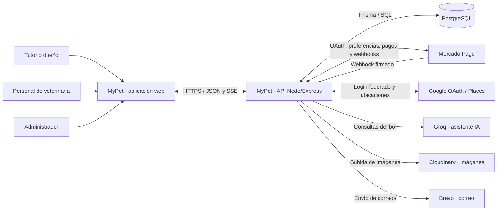
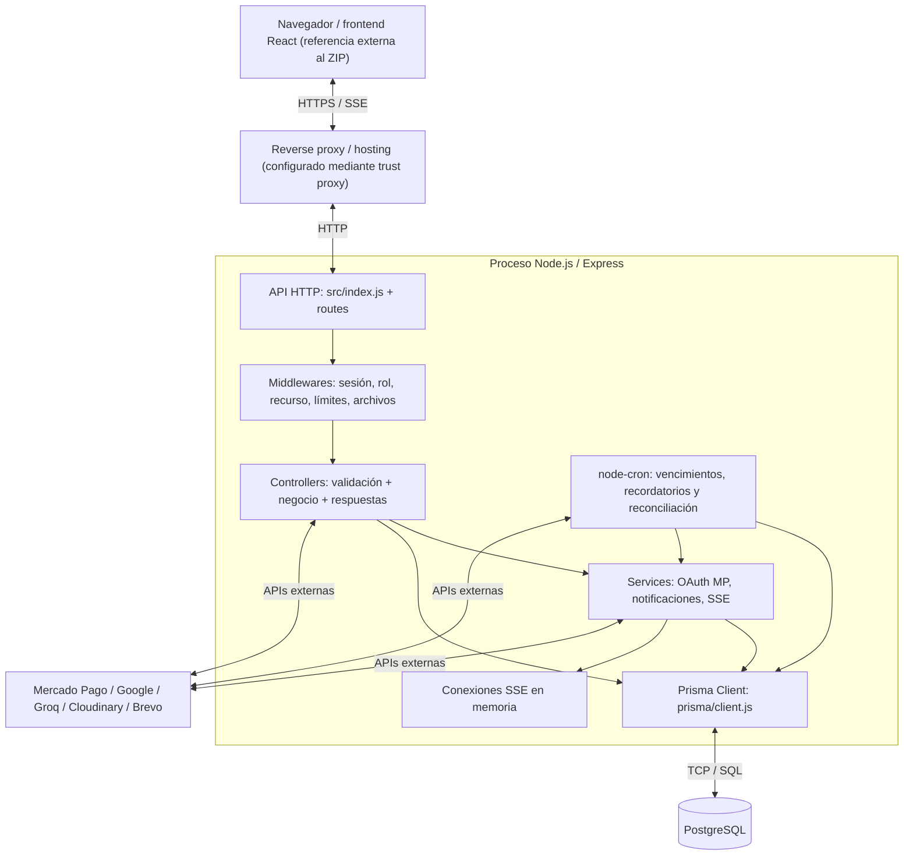
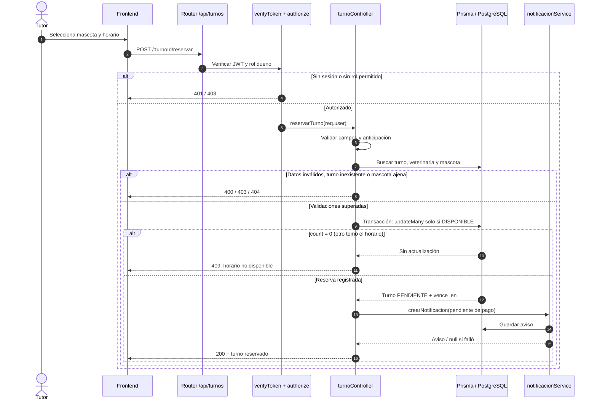
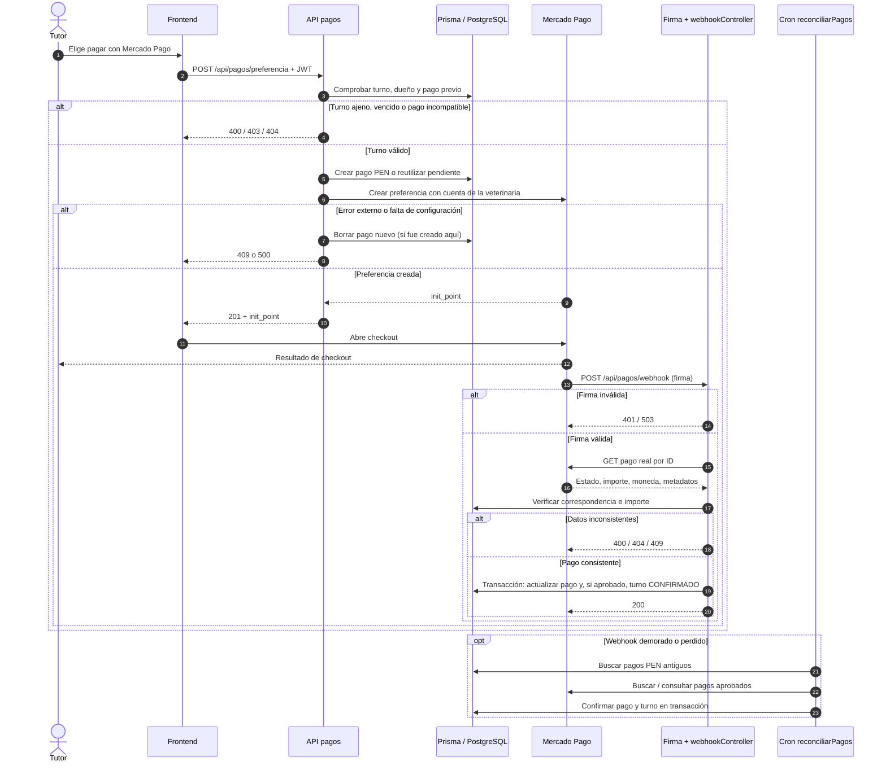
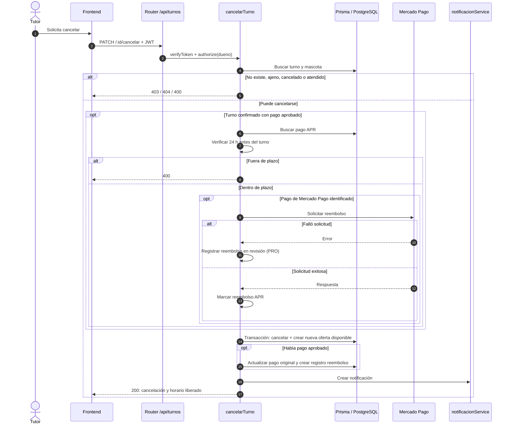
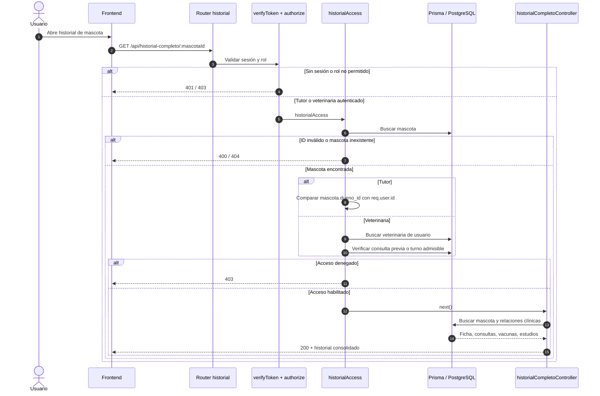

# MyPet — 04. Arquitectura del backend


## 0. Propósito, método y límites

Este documento explica **cómo funciona y cómo está organizado el servidor existente** de MyPet para que otra persona pueda recorrer el código sin leerlo completo. No es un catálogo de endpoints, un diccionario de tablas ni un informe de vulnerabilidades. Esos aspectos corresponden, respectivamente, a la documentación de API, Base de datos y Seguridad.

**Método empleado:** inspección estática del árbol `src/`, rutas, controllers, middlewares, servicios, configuración, tareas y `prisma/schema.prisma`; reconstrucción de flujos a partir de llamadas reales. Se realizó un chequeo sintáctico de los 102 archivos `.js` del ZIP con `node --check`, sin errores de sintaxis. **No se ejecutaron pruebas de integración**, ni el servidor, ni pagos reales, ni se accedió a dashboards de producción. Los diagramas representan el código inspeccionado, no una certificación de funcionamiento en producción.

**Convención de evidencia:**

- **Verificado en código:** existe en los archivos inspeccionados; las referencias son rutas relativas al repositorio, suponiendo que este documento se guarde en `docs/` y el servidor en `server/`.
- **Inferencia o comportamiento condicional:** resultado deducido de la lógica visible, pendiente de comprobar ejecutándola.
- **A confirmar:** requiere al Tech Lead, equipo de infraestructura, artefactos faltantes o una prueba real.

Las decisiones históricas se documentan como **decisiones observadas**. No se atribuyen motivos ni debates de diseño al equipo cuando no aparecen documentados.

## 1. Mapa general

### 1.1. Diagrama de contexto



**Lectura:** los usuarios interactúan con la aplicación web; el backend centraliza reglas de negocio, autorización y acceso a los proveedores. PostgreSQL es la base relacional utilizada por Prisma. El código no utiliza `@supabase/supabase-js`; si PostgreSQL está alojado en Supabase, ese dato de infraestructura debe confirmarse externamente. El frontend está representado como contenedor lógico, pero su implementación concreta no fue incluida en este ZIP.

### 1.2. Diagrama de contenedores y procesos



**Límite operativo:** `jobs/` y `services/sseService.js` se ejecutan **dentro del proceso del servidor**, no en servicios independientes según el código disponible. Si hay varias réplicas del proceso, cada una conserva su propio mapa SSE y arranca sus propios crons. El deployment real, el número de réplicas y el manejo de suspensión del hosting están **a confirmar**.

### 1.3. Stack y librerías observadas

| Componente | Tecnología vista en el código | Evidencia / función |
|---|---|---|
| Runtime/API | Node.js (versión ejecutada a confirmar), módulos ES (`"type": "module"`), Express **5.2.1** | `server/package.json`, `server/package-lock.json`, [`src/index.js`](../server/src/index.js) |
| Base de datos | PostgreSQL mediante Prisma CLI y `@prisma/client`, ambos **5.22.0** | Manifiestos, [`prisma/client.js`](../server/prisma/client.js), [`prisma/schema.prisma`](../server/prisma/schema.prisma) |
| Autenticación | `jsonwebtoken` **9.0.3**, `bcrypt` **6.0.0**, `google-auth-library` **11.0.2** | Manifiestos, [`authController.js`](../server/src/controllers/authController.js) |
| Archivos | `multer` **2.2.0**, `cloudinary` **2.10.0** | Manifiestos, [`middleware/upload.js`](../server/src/middleware/upload.js), [`uploadController.js`](../server/src/controllers/uploadController.js) |
| Pagos | SDK `mercadopago` **3.3.0**, OAuth por veterinaria | Manifiestos, [`pagoController.js`](../server/src/controllers/pagoController.js), [`mercadoPagoOAuthService.js`](../server/src/services/mercadoPagoOAuthService.js) |
| Bot IA | SDK `groq-sdk` **1.6.0** | Manifiestos, [`botController.js`](../server/src/controllers/botController.js) |
| Ubicaciones | API de Google Places con `fetch` de Node | [`placesController.js`](../server/src/controllers/placesController.js) |
| Correos | API HTTPS de Brevo mediante `fetch` (no Nodemailer en el flujo activo inspeccionado) | [`utils/mailer.js`](../server/src/utils/mailer.js) |
| Tareas programadas | `node-cron` **4.5.0** | Manifiestos, [`jobs/turnoJobs.js`](../server/src/jobs/turnoJobs.js) |
| Rendimiento y límites | `compression` **1.8.2**, `cors` **2.8.6**, `express-rate-limit` **8.7.0** | Manifiestos, `src/index.js`, `middleware/` |
| Notificaciones en tiempo real | SSE (`text/event-stream`), `Map` en memoria | `services/sseService.js`, `NotificacionController.js` |

Las versiones numéricas de esta tabla son las **resueltas en `package-lock.json`**, no una medición de las versiones en ejecución de Render o del entorno local.

### 1.4. Inventario de dependencias y ejecución

**Origen:** `server/package.json` (`dependencies`, `devDependencies` y `scripts`) y el lockfile de npm con `lockfileVersion: 3`. La columna «declarada» conserva `^` (rango semántico permitido); la columna «fijada» refleja la resolución exacta del lockfile.

| Paquete directo | Versión declarada | Versión fijada | Función o situación observada |
|---|---|---|---|
| `express` | `^5.2.1` | `5.2.1` | Servidor HTTP y routing. |
| `@prisma/client` | `^5.22.0` | `5.22.0` | Consultas y transacciones sobre PostgreSQL. |
| `prisma` (desarrollo) | `^5.22.0` | `5.22.0` | CLI y herramientas de esquema. |
| `jsonwebtoken` | `^9.0.3` | `9.0.3` | Emisión y validación de JWT. |
| `bcrypt` | `^6.0.0` | `6.0.0` | Contraseñas. |
| `google-auth-library` | `^11.0.2` | `11.0.2` | Autenticación federada con Google. |
| `cors` | `^2.8.6` | `2.8.6` | Orígenes HTTP permitidos. |
| `compression` | `^1.8.0` | `1.8.2` | Compresión de respuestas. |
| `dotenv` | `^17.4.2` | `17.4.2` | Variables de entorno. |
| `express-rate-limit` | `^8.7.0` | `8.7.0` | Limitación de solicitudes donde se aplica. |
| `multer` | `^2.2.0` | `2.2.0` | Recepción de archivos. |
| `cloudinary` | `^2.10.0` | `2.10.0` | Almacenamiento de imágenes. |
| `mercadopago` | `^3.3.0` | `3.3.0` | Integración de pagos. |
| `groq-sdk` | `^1.6.0` | `1.6.0` | Bot de IA activo observado. |
| `node-cron` | `^4.5.0` | `4.5.0` | Tareas programadas en el proceso Node. |
| `@google/generative-ai` | `^0.24.1` | `0.24.1` | Declarada; referencia localizada en `config/gemini.js`, candidata a revisión como integración heredada. |
| `mongoose` | `^9.6.3` | `9.8.0` | Declarada; referencias en modelos y `config/db.js` heredados. No confundir dependencia instalada con conexión Mongo activa. |
| `nodemailer` | `^9.0.3` | `9.0.3` | Declarada, pero sin importación directa identificada en el árbol JavaScript recibido; el envío actual inspeccionado usa Brevo por `fetch`. |
| `nodemon` (desarrollo) | `^3.1.14` | `3.1.14` | Reinicio del servidor durante el desarrollo. |

**Scripts declarados:** `npm run dev` ejecuta `nodemon src/index.js`; `npm start` ejecuta `node src/index.js`. El punto de entrada declarado es `src/index.js` y el sistema de módulos es ESM (`"type": "module"`). Estos son los comandos declarados, no pruebas de ejecución realizadas.

**Compatibilidad de Node:** `package.json` **no define `engines.node`**. Sin embargo, el lockfile registra que `google-auth-library@11.0.2` requiere **Node >=22**, `mongoose@9.8.0` requiere **Node >=20.19.0** y `node-cron@4.5.0` requiere **Node >=20**. Por tanto, el mínimo más restrictivo **según las dependencias fijadas es Node 22**; esto **no demuestra** cuál versión ejecuta realmente el hosting ni valida una instalación en producción. Corresponde confirmar esa versión con DevOps y, si el equipo lo aprueba, explicitarla en `engines` y en la configuración de despliegue.

**Lectura de mantenimiento:** que una dependencia permanezca en el manifiesto no prueba que se use. Las candidatas a limpieza `@google/generative-ai`, `mongoose` y `nodemailer` deben contrastarse con todo el repositorio (tests, scripts, herramientas de migración y despliegue) antes de eliminarlas. No se recomienda realizar cambios de dependencias como parte del relevamiento S0-04.

## 2. Arranque del servidor y recorrido de una petición

### 2.1. Arranque

1. `src/index.js` carga variables con `dotenv/config` y crea `express()`.
2. Configura `trust proxy = 1`, CORS con orígenes de `CLIENT_URL` más URLs locales, compresión y parser JSON.
3. Monta el router general en `/api` y el router de imágenes en `/api/upload`; además define `/` y `/health`.
4. Invoca `connectDB()` de `prisma/client.js`: abre Prisma y ejecuta `SELECT 1` antes de aceptar tráfico. Si falla, registra el error y termina el proceso con código 1.
5. Inicia `app.listen(PORT)` y luego `iniciarJobsTurnos()`.
6. Ante `SIGTERM` o `SIGINT`, intenta cerrar conexiones HTTP y Prisma; dispone de un apagado forzado después de 10 segundos. El cierre de conexiones HTTP activas incluye las SSE.

`GET /health` consulta PostgreSQL: responde `{ ok: true }` o `503` si la consulta falla. No equivale a una comprobación de todos los proveedores externos.

### 2.2. Recorrido HTTP representativo: reservar turno

```text
Frontend
  → Express (CORS, compression, express.json)
  → routes/index.js, prefijo /api/turnos
  → routes/rutasTurnos.js
  → middleware/auth.js: verifyToken
  → middleware/auth.js: authorize('dueno')
  → controllers/turnoController.js: reservarTurno
  → prisma/client.js → PostgreSQL
  → services/notificacionService.js → PostgreSQL + SSE local
  → HTTP JSON al frontend
```

Se sigue este camino desde [`routes/rutasTurnos.js`](../server/src/routes/rutasTurnos.js). El router organiza **método, URL, controles y handler**; el controller aplica validaciones y reglas de negocio y llama directamente a Prisma. En esta arquitectura **no existe una capa de repositorios general**: el acceso a datos está distribuido entre controllers, middlewares, services y jobs. No confundir este recorrido con una regla universal: algunos endpoints llaman a servicios externos y otros contienen middlewares propios.

**Orden de rutas:** los routers bajo `/auth` comparten prefijo; varios routers del historial están montados en `/`; `/turnos/admin` se monta antes de `/turnos`. El orden influye cuando hay patrones solapados. [`routes/index.js`](../server/src/routes/index.js).

## 3. Fichas por carpeta y módulo

> Regla actual observada: las rutas enlazan handlers; gran parte de la lógica de negocio, autorización contextual y consultas a Prisma reside en los controllers. `services/` **no** encapsula toda la lógica de negocio; contiene tres servicios específicos. Las reglas siguientes distinguen esta realidad de las convenciones que convendría consolidar.

### `src/config/`

- **Para qué sirve:** inicialización de clientes externos y lectura de configuración/secretos.
- **Qué va / qué no:** credenciales y adaptadores de infraestructura; no reglas HTTP ni tratamientos clínicos.
- **Depende de:** variables de entorno y SDKs. **Usado por:** controllers, middlewares y utilidades.
- **Archivos principales:** [`security.js`](../server/src/config/security.js) (`JWT_SECRET` obligatorio), [`cloudinary.js`](../server/src/config/cloudinary.js), [`mercadopago.js`](../server/src/config/mercadopago.js) (cliente global todavía utilizado en reembolsos), [`botPrompt.js`](../server/src/config/botPrompt.js).
- **A confirmar:** si [`db.js`](../server/src/config/db.js) (Mongoose) y [`gemini.js`](../server/src/config/gemini.js) (Gemini) pueden retirarse; no aparecen importados en la ruta activa inspeccionada.

### `src/constants/`

- **Para qué sirve:** agrupar constantes compartidas.
- **Qué va / qué no:** códigos y categorías comunes; no consultas a base de datos.
- **Depende de:** ningún proveedor externo. **Usado por:** el modelo heredado `models/Veterinaria.js`.
- **Archivo principal:** [`categoriasServicio.js`](../server/src/constants/categoriasServicio.js).
- **A confirmar:** continuidad de este archivo tras retirar modelos Mongo; muchos códigos de estado vigentes residen hoy en controllers/services en lugar de una carpeta común.

### `src/controllers/`

- **Para qué sirve:** recibir `req`, validar, consultar datos, ejecutar operaciones y construir `res`.
- **Qué va / qué no:** lógica del caso de uso y traducción a respuestas HTTP **según el estado actual**; las rutas no deberían contener esta lógica. Como mejora, separar reglas complejas reutilizables de la capa HTTP.
- **Depende de:** Prisma, middlewares previos (`req.user`, `req.historialAccess`), servicios y proveedores externos. **Usado por:** `routes/` y algunos `jobs/` (por ejemplo, `liberarTurnosVencidos`).
- **Archivos principales por área:** autenticación (`authController.js`, `verificacionController.js`), usuarios (`userController.js`), mascotas (`mascotaController.js`), veterinarias (`veterinariaController.js`, `adminVeterinariaController.js`, `mercadoPagoVeterinariaController.js`), turnos (`turnoController.js`, `TurnosAdmin.js`, `disponibilidadController.js`), pagos (`pagoController.js`, `webhookController.js`), clínica (`consultaController.js`, `historialCompletoController.js`, `fichaMedicaController.js`, `estudioController.js`, `vacunaController.js`), foro (`publicacionController.js`, `ReporteController.js`), y notificaciones (`NotificacionController.js`). También existen dashboard, bot, lugares, reseñas, carga de imágenes, constantes y zonas.
- **A confirmar:** estrategia de división de controllers extensos y el destino de [`controllers/index.js`](../server/src/controllers/index.js), que solo contiene un comentario.

### `src/jobs/`

- **Para qué sirve:** ejecutar trabajo programado sin una petición HTTP.
- **Qué va / qué no:** planificación y coordinación de procesos periódicos; no respuestas Express.
- **Depende de:** `node-cron`, Prisma, controladores de turnos, servicios de MP, notificaciones y correo. **Usado por:** `src/index.js` al arrancar.
- **Archivo principal:** [`turnoJobs.js`](../server/src/jobs/turnoJobs.js).
- **A confirmar:** operación con varias réplicas, zona horaria efectiva del host y política de ejecución cuando el host duerme o reinicia.

### `src/middleware/`

- **Para qué sirve:** controles intermedios por solicitud (identidad, roles, propiedad, firma, cargas y límites).
- **Qué va / qué no:** validaciones transversales previas al handler; no responder como controller salvo rechazos y errores propios.
- **Depende de:** Express, JWT, Prisma, Multer, `express-rate-limit`. **Usado por:** `routes/`.
- **Archivos principales:** [`auth.js`](../server/src/middleware/auth.js), [`roles.js`](../server/src/middleware/roles.js), [`esAdmin.js`](../server/src/middleware/esAdmin.js), [`historialAccess.js`](../server/src/middleware/historialAccess.js), [`verifyTokenSSE.js`](../server/src/middleware/verifyTokenSSE.js), [`mercadoPagoWebhookSignature.js`](../server/src/middleware/mercadoPagoWebhookSignature.js), [`upload.js`](../server/src/middleware/upload.js), `botRateLimiter.js` y `placesRateLimiter.js`.
- **A confirmar:** unificación de `authorize`, `verificarRol` y `esAdmin`; posible retiro de [`ownerTurno.js`](../server/src/middleware/ownerTurno.js), no referenciado en los routers inspeccionados.

### `src/models/`

- **Para qué sirve:** esquemas Mongoose de la implementación anterior.
- **Qué va / qué no:** modelos del motor Mongo heredado; **no** representa el modelo de persistencia activo de Prisma.
- **Depende de:** `mongoose`; `models/Veterinaria.js` depende también de `constants/categoriasServicio.js`. **Usado por:** no se identificaron importaciones desde los controllers activos recibidos.
- **Archivos principales:** `User.js`, `Mascota.js`, `Veterinaria.js`, `Turno.js`, `Pago.js`, `Publicacion.js`, `Reporte.js`, `Notificacion.js`.
- **A confirmar:** si otro script o rama utiliza estos modelos antes de retirarlos. El esquema vigente está en `prisma/schema.prisma`.

### `src/routes/`

- **Para qué sirve:** composición y registro de rutas por dominio funcional.
- **Qué va / qué no:** método/prefijo, middlewares y controllers; no reglas de negocio extensas.
- **Depende de:** Express, `middleware/`, `controllers/`. **Usado por:** `src/index.js`.
- **Archivos principales:** [`index.js`](../server/src/routes/index.js) (router general), `rutasTurnos.js`, `pagos.js`, `veterinarias.js`, `consulta.js`, `historialCompleto.routes.js`, `usuarios.js`, `notificaciones.js`, `uploadRoutes.js`, además de routers de autenticación, administración, mascotas, foro y catálogos.
- **A confirmar:** consolidación de convenciones de nombre (`rutasX.js`, `x.routes.js`, `xRoutes.js`) y de controles por endpoint. **Importante:** `uploadRoutes.js` se registra directamente desde el punto de entrada, no desde el router general.

### `src/services/`

- **Para qué sirve:** funciones especializadas compartidas por controllers y jobs.
- **Qué va / qué no:** operaciones sobre proveedores y transporte de eventos; se recomienda no acoplarlas a `req/res`.
- **Depende de:** Prisma, SDK Mercado Pago, criptografía y memoria del proceso. **Usado por:** controllers, jobs.
- **Archivos principales:** [`mercadoPagoOAuthService.js`](../server/src/services/mercadoPagoOAuthService.js) (cuentas conectadas, tokens cifrados y renovación), [`notificacionService.js`](../server/src/services/notificacionService.js) (persistir y emitir aviso), [`sseService.js`](../server/src/services/sseService.js) (registro de streams en `Map`).
- **A confirmar:** si se planifica incorporar servicios de casos de uso para reducir el tamaño de controllers.

### `src/templates/`

- **Para qué sirve:** generar HTML/asunto de comunicaciones por correo, con helper de escape.
- **Qué va / qué no:** presentación de correo y variables visibles al usuario; no envío de red ni persistencia.
- **Depende de:** datos proporcionados por `utils/mailer.js` y controllers; varios templates usan `escapeHtml.js`. **Usado por:** controllers, `utils/mailer.js`.
- **Archivos principales:** `emailVerificacionCuenta.js`, `emailResetPassword.js`, `emailRecordatorio.js`, `emailSuspensionCuenta.js`, `emailCambioEstadoCuenta.js`, `emailRechazoVeterinaria.js`, `emailPublicacionDadaDeBaja.js`, [`escapeHtml.js`](../server/src/templates/escapeHtml.js).
- **A confirmar:** convenciones de sanitización homogéneas entre plantillas.

### `src/utils/`

- **Para qué sirve:** helpers de correo, formato, fechas, tokens, catálogos, concurrencia y validaciones específicas.
- **Qué va / qué no:** funciones reutilizables; no deberían actuar como controllers HTTP.
- **Depende de:** Prisma en `catalogos.js`, Brevo en `mailer.js`, Node `crypto` en `tokens.js`. **Usado por:** controllers y jobs.
- **Archivos principales:** [`mailer.js`](../server/src/utils/mailer.js), [`catalogos.js`](../server/src/utils/catalogos.js), [`concurrencia.js`](../server/src/utils/concurrencia.js), `fechas.js`, `formatearHora.js`, `tokens.js`, `validacionesPublicacion.js`.
- **A confirmar:** `utils/formatearHora.js` no tiene referencias de importación encontradas; varios módulos repiten helpers de formato.

### `src/validators/`

- **Para qué sirve:** validar formato y fortaleza de entradas de uso transversal.
- **Qué va / qué no:** funciones de validación reutilizables, no operaciones de BD.
- **Depende de:** JavaScript. **Usado por:** `authController.js`.
- **Archivos principales:** [`emailValidator.js`](../server/src/validators/emailValidator.js), [`passwordValidator.js`](../server/src/validators/passwordValidator.js).
- **A confirmar:** alcance de adopción de validators en el resto de controllers, que todavía tienen validaciones locales.

### Carpeta adicional: `server/prisma/`

- **Para qué sirve:** punto central de conexión y mapeo relacional.
- **Qué va / qué no:** cliente Prisma, esquema y configuración de conexión; no reglas HTTP.
- **Depende de:** `@prisma/client`, `DATABASE_URL`, `DIRECT_URL`. **Usado por:** controllers, services, middlewares y jobs.
- **Archivos:** [`client.js`](../server/prisma/client.js) (instancia compartida, `$connect`, `$disconnect`, `SELECT 1`), [`schema.prisma`](../server/prisma/schema.prisma) (generador Prisma Client, `provider = "postgresql"`).
- **A confirmar:** políticas operativas de conexión, migraciones aplicadas y privilegios del usuario PostgreSQL en producción. Las tablas y columnas se explicarán en el documento específico de Base de datos.

## 4. Autenticación y autorización

### 4.1. Emisión y verificación del token

**Emisión.** `controllers/authController.js` valida registro/inicio de sesión, contrasta contraseñas con `bcrypt` (o valida identidad federada mediante Google), y firma un JWT con `jsonwebtoken` y secreto leído desde `config/security.js`. La función `generarJwt` configura vencimiento de **24 horas**. Las cuentas creadas por correo necesitan verificación de email; el alta almacena hash de token de verificación y trata el envío como una operación posterior a la escritura en BD.

**En rutas protegidas.** `middleware/auth.js`:

1. Extrae el token del encabezado `Authorization`.
2. Verifica la firma con **HS256**, vencimiento e identificador `id`, y rechaza tokens con `aud` o `purpose` definidos en el payload.
3. Busca al usuario mediante Prisma, o usa una caché `Map` de **30 segundos** y hasta **1.000 entradas**; solamente almacena usuarios activos y verificados.
4. Rechaza cuentas inexistentes/inactivas/sin verificar, y crea `req.user = { id, email, rol }` a partir de la BD/caché, no del rol que venga en el JWT.
5. Invoca `next()`.

`invalidarUsuarioCache(usuarioId)` está exportada y es utilizada desde `userController.js` al modificar cuentas. **Límite:** la invalidación solo afecta el proceso Node que recibe esa llamada; no es una caché distribuida.

### 4.2. Roles, recursos y acceso clínico

- **Roles:** `dueno`, `veterinaria`, `administrador`, evaluados mediante `authorize(...roles)` y también con `verificarRol(...)` o `esAdmin` en distintos routers. El dato común es `req.user.rol`.
- **Propiedad:** la pertenencia de mascota y de turno se valida en controllers específicos; ser `dueno` no habilita a operar sobre mascotas ajenas.
- **Historial:** [`middleware/historialAccess.js`](../server/src/middleware/historialAccess.js) verifica UUID, existencia y vínculo de acceso. Tutor: mascota propia. Veterinaria: una consulta previa en esa veterinaria o un turno relacionado cuyo estado no sea pendiente/cancelado; la autorización de entradas individuales exige pertenencia a la veterinaria de la entrada. El middleware admite administrador en algunas ramas, aunque algunas rutas lo restringen antes con `authorize('dueno', 'veterinaria')`.
- **SSE:** `verifyTokenSSE.js` recibe el JWT por parámetro `token` en la URL porque `EventSource` no envía encabezados personalizados como `Authorization`; vuelve a consultar cuenta y rol en Prisma. Este camino no usa la caché de `auth.js`.
- **Proveedor externo:** el webhook MP **no** pasa por `verifyToken`; usa una firma HMAC a través de `middleware/mercadoPagoWebhookSignature.js`, además de verificar el pago contra Mercado Pago dentro del controller.

La revisión de controles de acceso desde una perspectiva de vulnerabilidades pertenece al documento de **Seguridad**. Aquí se describe la organización existente y se señalan inconsistencias de diseño para seguimiento.


## 5. Flujos críticos (diagramas de secuencia)

> Los diagramas describen **el recorrido implementado en la copia analizada**. `alt` representa caminos alternativos observables en el código. Ningún diagrama acredita pruebas de integración ni comportamiento real del proveedor externo.

### 5.1. Flujo: reserva de turno

**Objetivo:** un tutor toma un turno disponible para su mascota y conserva temporalmente el horario hasta elegir la modalidad de pago.  
**Actores:** tutor, frontend, Express, autenticación, controller de turnos, PostgreSQL y notificaciones.



**Reglas visibles:** anticipación mínima **10 horas**; plazo de pago **3 horas** (`controllers/turnoController.js`); mascota del usuario autenticado; veterinaria activa. La actualización condicional protege el **mismo turno** frente a reservas concurrentes: se modifica únicamente si sigue en `DISPONIBLE`. La transacción cubre la modificación del turno y su lectura posterior, **no** la creación de notificación. `crearNotificacion` captura su propio error y devuelve `null`: un fallo de esa notificación **no provoca por sí mismo un HTTP 500** en este flujo.

**Caminos alternativos:** 400 por campos/anticipación; 401/403 en middlewares; 403 por pertenencia; 404 por turno/veterinaria; 409 por carrera; 500 por error no controlado en controller/Prisma. El vencimiento del estado pendiente se procesa separadamente por un cron.

**Archivos:** [`routes/rutasTurnos.js`](../server/src/routes/rutasTurnos.js), [`middleware/auth.js`](../server/src/middleware/auth.js), [`controllers/turnoController.js`](../server/src/controllers/turnoController.js), [`services/notificacionService.js`](../server/src/services/notificacionService.js), [`jobs/turnoJobs.js`](../server/src/jobs/turnoJobs.js).

**A confirmar:** prueba real de concurrencia con dos solicitudes simultáneas; cómo representa el frontend los errores 409 y el tiempo de expiración.

### 5.2. Flujo: pago con Mercado Pago y confirmación por webhook

**Objetivo:** permitir pagar un turno reservado y confirmar el turno únicamente después de validar el estado real del pago con Mercado Pago.  
**Actores:** tutor, frontend, backend MyPet, Mercado Pago, proveedor PostgreSQL y job de reconciliación.



**Diseño observado:** `crearPreferenciaPago` comprueba que la mascota pertenezca al usuario, que la reserva no haya vencido, y toma el monto del registro de turno; no lo recibe del frontend. La preferencia conserva `external_reference = turno_id`, los IDs en `metadata` y la `notification_url`. `obtenerClienteMercadoPago` utiliza las credenciales OAuth de **esa veterinaria**. El webhook se autentica mediante firma HMAC, consulta el pago **directamente al proveedor**, compara veterinaria, referencias, moneda ARS e importe, y recién entonces actualiza el pago y eventualmente el turno en una transacción.

**Distinción clave:** `back_urls` retorna al usuario a páginas informativas, **no** es una prueba de pago. La confirmación depende del webhook o del job de reconciliación. La firma del webhook se valida con `MP_WEBHOOK_SECRET`, el encabezado `x-signature`, `x-request-id`, `data.id` y una ventana temporal de 300 segundos.

**Caminos alternativos:** cuenta de veterinaria no conectada (`MP_NOT_CONNECTED`), error al crear preferencia, falta de variables públicas, pago rechazado/en proceso, firma inválida, importe/metadatos incompatibles, proveedor inaccesible, webhook perdido y reconciliación posterior. La reconciliación toma lotes de hasta 20 turnos con pagos pendientes de antigüedad mínima de cinco minutos.

**Archivos:** [`routes/pagos.js`](../server/src/routes/pagos.js), [`controllers/pagoController.js`](../server/src/controllers/pagoController.js), [`controllers/webhookController.js`](../server/src/controllers/webhookController.js), [`middleware/mercadoPagoWebhookSignature.js`](../server/src/middleware/mercadoPagoWebhookSignature.js), [`services/mercadoPagoOAuthService.js`](../server/src/services/mercadoPagoOAuthService.js), [`jobs/turnoJobs.js`](../server/src/jobs/turnoJobs.js).

**A confirmar:** prueba end-to-end de pagos con credenciales de test, política de reintentos de Mercado Pago, configuración de webhooks en producción y conciliación ante duplicados concurrentes. El código permite describir la estrategia, no certificar la entrega del proveedor.

### 5.3. Flujo: cancelación de turno y reembolso

**Objetivo:** cancelar un turno propio, liberar el horario y registrar el tratamiento del reembolso cuando corresponda.  
**Actores:** tutor, frontend, controlador de turnos, Prisma, Mercado Pago y notificaciones.



**Reglas visibles:** los turnos ajenos, cancelados o atendidos no se pueden cancelar por esta ruta; cuando el turno confirmado tiene pago aprobado, se exige **24 horas** de anticipación. El controlador intenta el reembolso remoto **antes** de la transacción que cancela el turno y crea un registro de oferta horaria nueva. Si el reembolso remoto falla, registra el reembolso como en revisión (`PRO`) y continúa. Si no hay pago aprobado, no sigue la rama de reembolso. En la modalidad de efectivo hay un pago local pendiente y no se aplica automáticamente la misma lógica de reembolso.

**Caminos alternativos y límite transaccional:** un reembolso remoto aprobado y un fallo posterior de PostgreSQL no constituyen una única transacción distribuida: la compensación/manualidad está **a confirmar**. En la ruta de cancelación se usa [`config/mercadopago.js`](../server/src/config/mercadopago.js) con `MP_ACCESS_TOKEN` general, mientras las preferencias usan OAuth por veterinaria; es una diferencia arquitectónica que conviene verificar y decidir con el Tech Lead antes de un cambio de código. El éxito del registro no demuestra necesariamente la acreditación efectiva de un reintegro en la cuenta del pagador.

**Archivos:** [`routes/rutasTurnos.js`](../server/src/routes/rutasTurnos.js), [`controllers/turnoController.js`](../server/src/controllers/turnoController.js), [`config/mercadopago.js`](../server/src/config/mercadopago.js), [`services/notificacionService.js`](../server/src/services/notificacionService.js).

**A confirmar:** qué cuenta de MP debe realizar cada devolución, manejo operativo de reintegros fallidos, qué sucede si una cancelación se reintenta tras reembolso externo exitoso y pruebas con medios de pago diferentes.

### 5.4. Flujo: acceso al historial clínico

**Objetivo:** permitir que un tutor o una veterinaria acceda a información clínica de una mascota bajo los controles actualmente implementados.  
**Actores:** usuario, frontend, routers clínicos, middleware de sesión, middleware de acceso, controller y Prisma.



**Diseño observado:** para `/historial-completo/:mascotaId` el router aplica `verifyToken`, `authorize('dueno','veterinaria')` y luego `historialAccess`; el middleware valida identificador, existencia de mascota y propiedad/vínculo clínico. Para veterinaria, admite consulta previa o turno cuyo estado no sea pendiente/cancelado. `historialCompletoController` consulta mediante Prisma un árbol de relaciones (ficha médica, consultas, vacunas, estudios) y lo transforma para responder al cliente. Otras rutas (`/historial/:mascotaId`, `/historial/entrada/:id`, `/ficha-medica/...`) usan combinaciones similares, no idénticas, de filtros y handlers.

**Caminos alternativos:** 400 por formato de ID; 401 por credenciales inválidas; 403 por rol o falta de relación; 404 si la mascota/recurso no existe; 500 por errores de lectura. La implementación de listado por consulta en `consultaController.js` agrega un filtro de veterinaria cuando corresponde; para el historial **completo** la consulta incluye relaciones clínicas de la mascota sin un filtro equivalente en todas las relaciones; verificar con el Tech Lead el alcance de datos que se desea mostrar a una veterinaria.

**Archivos:** [`routes/historialCompleto.routes.js`](../server/src/routes/historialCompleto.routes.js), [`routes/consulta.js`](../server/src/routes/consulta.js), [`middleware/historialAccess.js`](../server/src/middleware/historialAccess.js), [`controllers/historialCompletoController.js`](../server/src/controllers/historialCompletoController.js), [`controllers/consultaController.js`](../server/src/controllers/consultaController.js).

**A confirmar:** política formal de visibilidad del historial entre veterinarias y pruebas de accesos cruzados con perfiles de tutor/veterinaria reales.

## 6. Procesos automáticos y tiempo real

### 6.1. Jobs ejecutados dentro del proceso de la API

`src/index.js` llama a `iniciarJobsTurnos()` únicamente después de conectar Prisma e iniciar el listener HTTP. El módulo [`jobs/turnoJobs.js`](../server/src/jobs/turnoJobs.js) registra tres cron jobs con `node-cron`. Se ejecutan **cada 15 minutos, desfasados cinco minutos**, según el reloj y zona horaria configurados en el servidor (no se declara `timezone` en los `cron.schedule`).

| Job | Programación (minutos de cada hora) | Operación | Qué sucede si falla |
|---|---|---|---|
| Liberación de turnos vencidos | `0,15,30,45 * * * *` | `liberarTurnosVencidos`: pasa de `PENDIENTE` a `DISPONIBLE` registros con `vence_en` vencido; quita mascota, motivo y notas. | `try/catch`, registra error; se intentará de nuevo en otra ejecución; no hay cola persistente de fallos. |
| Recordatorios | `5,20,35,50 * * * *` | `enviarRecordatoriosTurnos`: busca turnos confirmados sin recordatorio, dentro de las próximas 24 h; envía email y crea aviso en la app. | Si el email falla, revierte `recordatorio_enviado` para reintentar; deduplica el aviso en app por usuario/tipo/mensaje. Hay manejo de errores por turno. |
| Reconciliación de pagos | `10,25,40,55 * * * *` | `reconciliarPagosPendientes`: consulta a MP por pagos locales pendientes, de más de 5 min de antigüedad, y confirma aprobados al validar importe, moneda y referencia. | Maneja excepciones por pago, las deja para una pasada posterior. Procesa máximo 20 turnos por ciclo, con concurrencia de 3. |

Un envoltorio `envolverJob` registra duración, captura errores inesperados y **evita solapamiento del mismo job dentro del mismo proceso** (`corriendo` booleano). No proporciona exclusión distribuida entre instancias. Para recordatorios y reconciliación se utiliza `mapConLimite` con concurrencia de 3.

**Riesgos operativos a decidir:** si el hosting suspende el servicio, no se ejecutan los cron mientras está dormido; si hay múltiples réplicas, cada una registra su propia programación, y la protección `corriendo` no coordina procesos diferentes. Hay condiciones/actualizaciones idempotentes en algunos trabajos, pero eso no equivale a un sistema de locks distribuido. La conducta real del despliegue, reinicio, observabilidad y necesidad de un scheduler externo están **a confirmar: DevOps / Tech Lead**.

### 6.2. Notificaciones mediante SSE

[`services/sseService.js`](../server/src/services/sseService.js) almacena conexiones activas en `Map<usuarioId, Set<res>>`. [`NotificacionController.js`](../server/src/controllers/NotificacionController.js) establece `text/event-stream`, indica reconexión a los 5 segundos y envía un *heartbeat* cada 25 segundos. Cuando se crea una notificación, [`services/notificacionService.js`](../server/src/services/notificacionService.js) la persiste primero en PostgreSQL y luego la emite a los streams locales; si falla la escritura en BD, registra el error y devuelve `null`. El frontend puede consultar notificaciones persistidas por HTTP aunque se haya perdido un evento en vivo.

**Limitación:** el `Map` es local a cada proceso; una notificación creada en instancia A no se emite automáticamente por SSE a clientes conectados en instancia B. `verifyTokenSSE` acepta token por parámetro de consulta; este mecanismo es distinto al encabezado `Authorization` usado en la mayoría de rutas. Recomendación arquitectónica condicional: evaluar un *pub/sub* compartido (por ejemplo Redis) si se despliegan múltiples instancias. **A confirmar:** cantidad de instancias en producción y estrategia de reconexión del frontend.

## 7. Integraciones externas y comportamiento ante fallas

| Proveedor / uso | Entrada y archivos | Espera / reintento visible | Si falla |
|---|---|---|---|
| **PostgreSQL** (hospedado por confirmar) | Prisma `prisma/client.js`, controllers, middleware y jobs | `connectDB()` y `SELECT 1` en el arranque; sin política general de reintentos en el cliente inspeccionado | Falla de arranque termina proceso; `/health` responde 503; handlers específicos retornan 500 u otro código. |
| **Mercado Pago** (preferencias, consultas, devoluciones) | SDK `mercadopago`; `pagoController`, `webhookController`, `turnoController` | Clientes MP configurados con `timeout: 5000` ms; no se observa política genérica automática de reintentos en controllers | Preferencia falla y se borra pago local recién creado; webhook puede responder error y existe reconciliación programada; devolución fallida se marca para revisión. |
| **Mercado Pago OAuth** (cuentas de veterinarias) | `mercadoPagoVeterinariaController`, `mercadoPagoOAuthService` | Solicitud de token con `fetch` **sin timeout explícito**; renovación anticipada cinco minutos antes del vencimiento; maneja una carrera de renovación recargando la configuración | Si falta conexión, error `MP_NOT_CONNECTED`; errores de OAuth pueden interrumpir preferencia o renovación. |
| **Brevo** (emails transaccionales) | `utils/mailer.js`, `templates/` | `fetch` a API HTTPS; `AbortSignal.timeout(15000)`; sin cola general de reintentos visible | Lanza error de red/HTTP; el comportamiento depende de cada llamador; el job de recordatorios restablece flag para reintentar. |
| **Google Places** (direcciones) | `controllers/placesController.js`, `routes/places.js` | `fetch` sin timeout explícito; el router incluye `placesRateLimiter` | Errores de status del proveedor generan 502, errores de ejecución 500; `ZERO_RESULTS` permitido para autocompletar. |
| **Google OAuth** (inicio de sesión) | `controllers/authController.js` y `google-auth-library` | Verificación del token desde backend; timeout específico no identificado en la configuración inspeccionada | El controller gestiona respuesta de autenticación fallida; detalles a probar sin credenciales reales. |
| **Groq** (chat del bot) | `controllers/botController.js`, `config/botPrompt.js` | SDK `groq-sdk`; no se configura timeout específico en la llamada observada; rate limiting de ruta | `catch` responde 500 con mensaje alternativo de siesta; filtros de entrada/salida y tope de caracteres. |
| **Cloudinary** (imágenes) | `controllers/uploadController.js`, `middleware/upload.js`, `config/cloudinary.js` | Multer en memoria, hasta 5 MB, MIME jpeg/png/webp; upload stream con SDK, sin timeout explícito propio | 400/413 por validación o tamaño; 500 si falla carga remota. |

**Nota sobre la guía de Notion:** allí se menciona **Nodemailer** como pista inicial. En el ZIP analizado, el correo transaccional **usa Brevo por HTTPS** en `utils/mailer.js`; no corresponde documentar Nodemailer como la integración activa sin nueva evidencia. También hay configuración antigua de **Gemini**, mientras el bot principal utiliza **Groq**.

**A confirmar (responsables):** acuerdos/SLA de proveedores, límites de cuota y reintentos del SDK, configuración de producción de los webhooks y el proveedor efectivo de PostgreSQL (Tech Lead y DevOps). No se incluyen URLs con secretos ni credenciales.

## 8. Errores, respuestas y registros

**Manejo de errores observado:** predomina `try/catch` dentro de controllers y middlewares, con respuestas JSON y `console.error`. Para validaciones y permisos aparecen HTTP **400, 401, 403, 404, 409**; para resultados exitosos **200/201**; fallas del servidor **500**, proveedores **502** en Places y **503** en `/health` o webhook no configurado; carga excesiva de imagen **413**. `uploadRoutes.js` contiene un manejador localizado para errores Multer.

**No se identificó un middleware centralizado de errores** registrado en `src/index.js`. En consecuencia, cada módulo decide qué cuerpo enviar. El formato no es uniforme: coexisten `{ success, data }`, `{ message }`, `{ error }`, `{ mensaje }`, `{ reply }`, etc. La estandarización pendiente debe alinearse con `Estandar del Backend.txt` y el formato que consuma el frontend; este documento **no prescribe cambiar contratos sin pruebas**.

**Logs observados:** `console.log`, `console.warn`, `console.error` en inicialización, correo, jobs, bot y controllers. Prisma registra errores en producción y errores/advertencias en desarrollo mediante su configuración. No aparece un sistema central de logs estructurados, trazas distribuidas o correlación de solicitudes en la copia inspeccionada. Algunos mensajes del mailer incluyen destinatarios y asuntos; el bot registra un fragmento de entrada sospechosa: **conviene definir una política de datos admisibles en logs** junto al equipo de Seguridad, sin incorporar aquí su clasificación de riesgo.

**Comportamiento frente a fallas parciales:** notificaciones in-app son *best effort* y no revierten reservas; jobs contienen errores y reintentan en ciclos posteriores en los casos descriptos; los webhooks hacen consultas al proveedor antes de confirmar; los reintegros externos y transacciones locales no conforman una única unidad atómica. No hay evidencia de un *circuit breaker* general ni de una cola de eventos persistente.

**A confirmar:** logging y monitoreo de la plataforma de hosting, política de retención de logs, alertas, ID de correlación, estrategia para errores HTTP no capturados y convenciones de pruebas de error.

## 9. Configuración y variables de entorno

[`src/index.js`](../server/src/index.js) importa `dotenv/config`; los módulos leen `process.env`. Algunos ofrecen valores predeterminados (por ejemplo `PORT || 3000`, `GROQ_MODEL`); otros fallan explícitamente si falta un secreto (`obtenerJwtSecret` en `config/security.js`, `mercadoPagoOAuthService.js`) o registran errores al intentar usar el proveedor.

| Grupo | Variables **referenciadas** en la copia | Cuando faltan (comportamiento visible) |
|---|---|---|
| Servidor y entorno | `PORT`, `NODE_ENV`, `CLIENT_URL`, `PUBLIC_BACKEND_URL` | `PORT` cae a 3000; CORS toma localhost más `CLIENT_URL`; preferencia de MP requiere las dos URLs públicas. |
| Persistencia | `DATABASE_URL`, `DIRECT_URL` en `prisma/schema.prisma` | Prisma necesita conexión válida al iniciar; si no conecta, el proceso termina. |
| JWT | `JWT_SECRET` | `obtenerJwtSecret()` arroja error si falta. |
| Mercado Pago | `MP_ACCESS_TOKEN`, `MP_CLIENT_ID`, `MP_CLIENT_SECRET`, `MP_REDIRECT_URI`, `MP_CREDENTIALS_ENCRYPTION_KEY`, `MP_WEBHOOK_SECRET` | Se validan diferentes variables por operación; algunos fallos producen 500/503; la configuración general de MP solo registra error por `MP_ACCESS_TOKEN` ausente. |
| Proveedores | `BREVO_API_KEY`, `MAIL_FROM`, `GOOGLE_MAPS_API_KEY`, `GROQ_API_KEY`, `GROQ_MODEL`, `CLOUDINARY_CLOUD_NAME`, `CLOUDINARY_API_KEY`, `CLOUDINARY_API_SECRET` | Cada módulo maneja la falta de configuración por separado; no se observa un validador global único. |
| Implementaciones heredadas | `MONGODB_URI`, `GEMINI_API_KEY` | Los módulos antiguos de Mongo/Gemini las mencionan, pero no se observó uso activo desde el punto de entrada actual. |

**Importante:** esta tabla muestra nombres de variables reconocibles en el código, no garantiza que sea un inventario exhaustivo de producción. **No se recibieron `.env` ni `.env.example`**; tampoco deben incorporarse valores reales al documento.

**A confirmar:** lista oficial por ambiente, variables obligatorias de deploy, configuración de secretos, forma de rotación, checks al despliegue y versión efectiva de Node. Propuesta: mantener `.env.example` sin valores sensibles y un chequeo centralizado de variables obligatorias.

## 10. Decisiones de arquitectura (registro breve)

> Las fichas documentan **decisiones que se observan en el código**, no debates históricos confirmados. La guía exige registrar fecha, participantes y alternativas; donde no hay evidencia se deja explícitamente **«A confirmar: Tech Lead»**.

### D-01: Prisma como vía de acceso a PostgreSQL

- **Fecha y participantes:** A confirmar: Tech Lead.
- **Contexto:** el backend necesita persistencia relacional para usuarios, turnos, historiales, pagos y otros recursos.
- **Opciones consideradas:** A confirmar: Tech Lead (no hay ADR histórico recibido).
- **Decisión observada:** `prisma/client.js` centraliza cliente y conexión; la mayoría de controllers y algunos middlewares/services/jobs lo utilizan directamente.
- **Por qué:** motivación original a confirmar; en el código se comprueban consultas tipadas y transacciones de Prisma.
- **Consecuencias:** acceso a datos uniforme a nivel de cliente, pero las reglas y las consultas están distribuidas; el esquema y migraciones se documentan en Base de datos.
- **Estado:** vigente en la copia analizada.

### D-02: Rutas delgadas y controllers con lógica de negocio

- **Fecha y participantes:** A confirmar: Tech Lead.
- **Contexto:** organización modular del servidor Express.
- **Opciones consideradas:** A confirmar; una alternativa futura sería separar *use cases* y repositorios.
- **Decisión observada:** los routers conectan endpoints a middleware/controllers; controllers como `turnoController` combinan validaciones, transacciones, lógica y respuestas.
- **Por qué:** motivación histórica a confirmar.
- **Consecuencias:** recorridos fáciles de encontrar por ruta; controllers extensos y acoplamiento directo a Prisma/proveedores, con mayor costo de pruebas y refactorización.
- **Estado:** vigente, a revisar para módulos complejos.

### D-03: Cada veterinaria conecta su propia cuenta de Mercado Pago

- **Fecha y participantes:** A confirmar: Tech Lead y responsables de pagos.
- **Contexto:** cobros por servicios de distintas veterinarias.
- **Opciones consideradas:** A confirmar.
- **Decisión observada:** OAuth MP por veterinaria, con credenciales cifradas en PostgreSQL y renovación del token en `mercadoPagoOAuthService.js`; las preferencias usan ese cliente.
- **Por qué:** razones de negocio/históricas a confirmar; la implementación permite direccionar el checkout a la cuenta conectada de cada veterinaria.
- **Consecuencias:** gestión de tokens, vencimientos, estado OAuth y credenciales separadas; revisar coherencia del reintegro, que hoy usa un cliente MP de configuración general.
- **Estado:** vigente para preferencias; a revisar para reembolsos.

### D-04: Jobs programados embebidos en la API

- **Fecha y participantes:** A confirmar: Tech Lead/DevOps.
- **Contexto:** automatizar vencimientos, recordatorios y pagos demorados.
- **Opciones consideradas:** A confirmar; opción futura: scheduler/worker externo.
- **Decisión observada:** `node-cron` se inicializa al arrancar la aplicación Express.
- **Por qué:** motivación original a confirmar.
- **Consecuencias:** implementación simple; depende de la disponibilidad y cantidad de instancias del proceso; no hay exclusión entre réplicas.
- **Estado:** vigente, condicionado a topología de despliegue.

### D-05: SSE con conexiones locales y persistencia de notificaciones

- **Fecha y participantes:** A confirmar: Tech Lead.
- **Contexto:** entregar notificaciones sin *polling* continuo.
- **Opciones consideradas:** A confirmar; alternativa futura: pub/sub compartido si hay escalado horizontal.
- **Decisión observada:** notificaciones en Prisma y canal SSE en `Map` del proceso Node.
- **Por qué:** motivación original a confirmar.
- **Consecuencias:** historial consultable aunque se corte el stream; emisión en vivo limitada a clientes de la instancia emisora.
- **Estado:** vigente, a revisar según despliegue.

### D-06: Consulta de estado de usuario con caché de 30 segundos

- **Fecha y participantes:** A confirmar: Tech Lead.
- **Contexto:** verificar estado actual de cuenta en rutas protegidas sin consultar Prisma en todas las solicitudes.
- **Opciones consideradas:** A confirmar.
- **Decisión observada:** `middleware/auth.js` conserva solo cuentas activas/verificadas hasta 30 segundos, con invalidación manual en modificaciones de usuario.
- **Por qué:** se declara en comentario del archivo que busca reducir consultas a la BD.
- **Consecuencias:** menor carga por solicitudes repetidas; estado de cuenta potencialmente desfasado si un cambio no invalida esa caché o se produce en otra instancia.
- **Estado:** vigente; coordinación entre réplicas a confirmar.

## 11. Deuda técnica y código a revisar

> **Alcance:** inventario para mantenimiento y decisiones de arquitectura, **no** una lista de vulnerabilidades con gravedad. El informe de Seguridad debe concentrar los hallazgos de seguridad. Las prioridades siguientes son una **propuesta de planificación**, no decisiones aprobadas.

| ID | Observación respaldada por código | Propuesta | Prioridad propuesta / responsable a confirmar |
|---|---|---|---|
| ARQ-01 | `src/models/*` son modelos Mongoose heredados; la persistencia activa observada usa `prisma/`. `config/db.js` intenta Mongo. | Verificar usos externos/scripts y retirar o archivar los elementos Mongo que no se necesiten, con PR separado. | Media / Backend |
| ARQ-02 | `config/gemini.js` referencia `@google/generative-ai`, aún declarada en `package.json`, mientras el bot actual usa `groq-sdk`. | Confirmar consumidores fuera del ZIP y, si se comprueba su desuso, retirar configuración y dependencia heredadas en PR separado. | Baja / Backend |
| ARQ-03 | `middleware/ownerTurno.js`, `utils/formatearHora.js` y `controllers/index.js` no tienen referencias de importación en el árbol enviado (este último es solo un comentario). | Revisar importaciones dinámicas/tests/otros paquetes y limpiar código si se confirma que está muerto. | Baja / Backend |
| ARQ-04 | Hay tres mecanismos de rol (`authorize`, `verificarRol`, `esAdmin`) y distintas claves de respuesta (`message`, `mensaje`, `error`). | Unificar middleware y contrato de errores gradualmente, con pruebas de regresión del frontend. | Media / Backend + Frontend |
| ARQ-05 | Controllers extensos concentran acceso a BD, reglas de negocio, integraciones y manejo HTTP. | Seleccionar los flujos de pagos/turnos para extraer servicios de caso de uso y facilitar tests, sin refactor masivo dentro de S0-04. | Media / Tech Lead |
| ARQ-06 | Los crons y SSE dependen de memoria/proceso local. | Confirmar topología; si hay réplicas, diseñar coordinación de jobs y distribución de eventos. | Media condicionada / DevOps |
| ARQ-07 | El reembolso MP en `turnoController.js` usa `config/mercadopago.js` (`MP_ACCESS_TOKEN` general), distinto del OAuth por veterinaria usado para cobros. | Validar cuenta pagadora y decidir una ruta de reintegro coherente con OAuth. Diseñar compensación ante fallo de BD tras reintegro remoto. | Alta para revisar / Pagos + Tech Lead |
| ARQ-08 | No hay manejador global HTTP de errores ni un sistema de logs estructurados visible. | Acordar formato uniforme, correlación y reglas de logging, conservar manejo específico donde haga falta. | Media / Backend |
| ARQ-09 | `mailer.js` y Places tienen políticas distintas de timeout; OAuth MP usa `fetch` sin timeout explícito; no hay estrategia general de reintentos. | Definir límites y políticas específicas por proveedor, con tests de fallas. | Media / Backend |
| ARQ-10 | `historialCompletoController` consulta todas las relaciones clínicas después de comprobar vínculo con una veterinaria; el listado de consultas específico sí filtra por veterinaria. | Confirmar la política funcional de acceso y alinear handlers/contratos según decisión de producto; enviar revisión de permisos al documento de Seguridad. | Alta para definir / Tech Lead + Producto |
| ARQ-11 | Se recibieron `package.json` y `package-lock.json` después del ZIP: ya hay versiones declaradas y fijadas, pero el proyecto no declara `engines.node`; no se conoce la versión realmente desplegada ni el SHA del código relevado. | Confirmar con DevOps el runtime de producción, decidir si declarar `engines.node` y registrar SHA de `develop` o de la rama auditada. | Media para cierre / Responsable S0-04 + DevOps |
| ARQ-12 | `crearPreferenciaPago` crea pago local antes de llamar a MP; intenta rollback si falla, pero esa compensación puede fallar. | Evaluar idempotencia, trazabilidad y reconciliación de intentos incompletos; documentar contratos de reintento. | Media / Pagos |
| ARQ-13 | `nodemailer` continúa declarado en `package.json`, aunque el correo observado en `utils/mailer.js` se envía mediante Brevo (`fetch`) y no se encontraron importaciones directas de Nodemailer en el ZIP. | Verificar referencias en scripts, tests y otras ramas antes de proponer eliminar el paquete. | Baja / Backend |
| ARQ-14 | `package.json` carece de `engines.node`; el lockfile fija `google-auth-library@11.0.2`, cuyo requisito es Node >=22. | Confirmar la versión de Node del despliegue y alinear documentación, CI y metadatos del proyecto. | Media / Backend + DevOps |

**No confundir con defectos ya corregidos:** en este código `uploadRoutes.js` **sí** aplica `verifyToken` y el filtro MIME **no admite SVG**; `esAdmin.js` lee `req.user.rol`. La auditoría anterior tiene utilidad histórica, pero no debe copiarse como estado vigente sin verificarlo.

## 12. Lista de verificación de entrega y revisión

| Criterio de la guía de Notion | Evidencia en este documento | Situación |
|---|---|---|
| Diagrama de contexto y de contenedores **editable** | §1, bloques Mermaid | Incluido; render visual en el repositorio a comprobar |
| Ficha para cada carpeta de `server/src/` | §3: once carpetas, más `server/prisma` | Incluido |
| Recorrido de una petición y responsabilidades de capas | §2 | Incluido |
| Autenticación, roles y acceso por recurso | §4 | Incluido |
| Cuatro flujos críticos con alternativas | §5: reserva, MP/webhook, cancelación/reembolso, historial | Incluido; validación end-to-end pendiente |
| Jobs, frecuencia y fallas | §6 | Incluido; comportamiento en producción por confirmar |
| Integraciones, tiempos de espera y fallas | §7 | Incluido; algunos timeouts no configurados explícitamente |
| Errores, logs y configuración | §8–9 | Incluido |
| Entradas de decisiones importantes | §10 | Incluido; historia y participantes por confirmar |
| Deuda y código obsoleto con propuestas | §11 | Incluido; propuestas no aprobadas |
| Una persona ajena al documento sigue un flujo | Prueba externa prevista por la guía | **Pendiente: revisor designado / Tech Lead** |
| Revisión formal del Tech Lead | Se realiza después de la entrega, según proceso indicado | **Pendiente de revisión posterior** |

### Pendientes para consolidar la versión final

1. **Cerrar trazabilidad de versión:** Express **5.2.1**, Prisma **5.22.0** y otras dependencias ya están documentadas desde `package-lock.json` (§1.3–1.4). **Falta** registrar el SHA del commit relevado, confirmar la versión real de Node en producción y comprobar que el ZIP y ambos manifiestos representan el mismo estado del repositorio; verificar también las rutas enlazadas.
2. **Validar los cuatro diagramas Mermaid** en el visor Markdown utilizado por el equipo, y ajustar etiquetas si el renderizador es antiguo.
3. **Probar al menos un recorrido completo** con frontend y backend local (recomendación explícita de la guía). Registrar fecha, entorno, actor y resultado sin capturar secretos en imágenes.
4. **Consultar decisiones e infraestructura** con Tech Lead/DevOps: política de historial compartido, reembolsos por veterinaria, instancias SSE/jobs, suspensión del hosting, versionado/despliegue.
5. **Someter a revisión posterior** por Tech Lead y, si aplica, DevOps/Seguridad. No presentar esa revisión como completada antes de recibirla.

**Cierre del relevamiento:** el archivo es un **borrador técnico documentado por inspección estática**, apto para incluir en una rama de documentación con pendientes explícitos. La aprobación final y las pruebas dinámicas no se efectuaron a partir del ZIP recibido.
